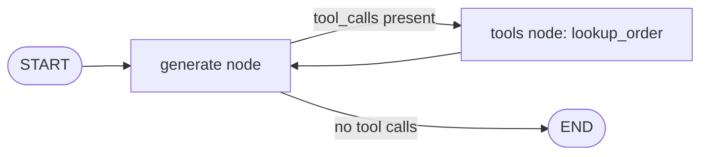
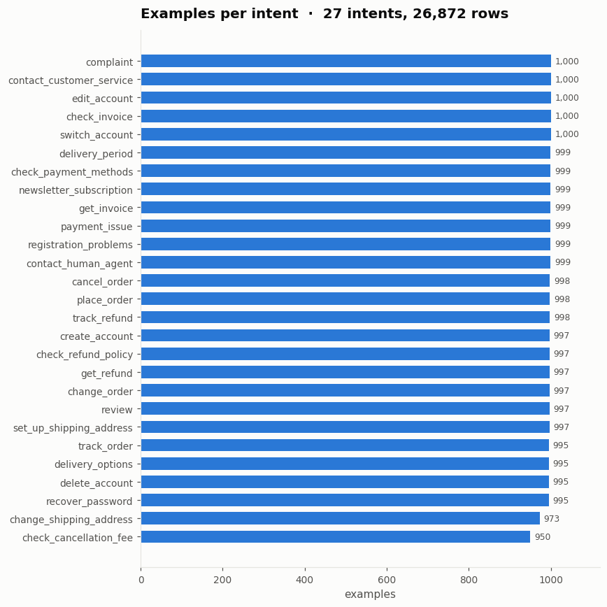
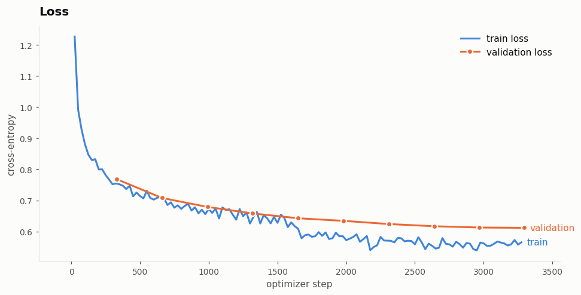
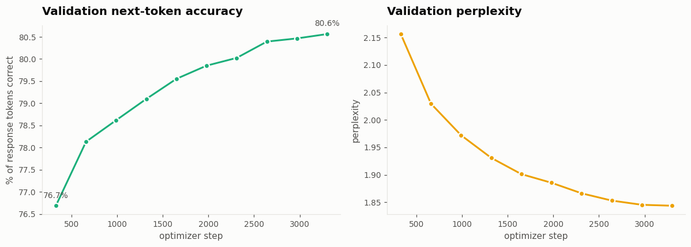
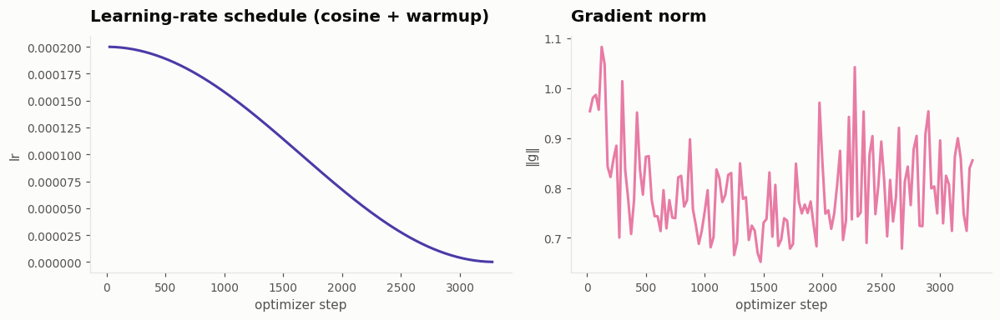

# Order Support Assistant

A customer-support chatbot that answers order questions (status, delivery date, tracking number) using **real data from a database**, built with a local Qwen2.5 model, LangGraph tool calling, a FastAPI backend, a Streamlit chat UI, and Docker.

> **Project story.** The first version fine-tuned `Qwen2.5-0.5B-Instruct` with LoRA on the Bitext customer-support dataset. The model answered fluently but could only produce template placeholders such as `{{Order Number}}`, never real values. This repo documents that experiment (see [Fine-tuning experiment](#fine-tuning-experiment-and-dataset-analysis)) and the final design, which uses an un-fine-tuned instruct model plus tool calling against an orders database.

---

## Table of contents

1. [Features](#features)
2. [Architecture](#architecture)
3. [Project structure](#project-structure)
4. [Quick start (Docker)](#quick-start-docker)
5. [Run without Docker](#run-without-docker)
6. [Configuration](#configuration)
7. [API reference](#api-reference)
8. [Sample data](#sample-data)
9. [Fine-tuning experiment and dataset analysis](#fine-tuning-experiment-and-dataset-analysis)
10. [Why the fine-tuned model was dropped](#why-the-fine-tuned-model-was-dropped)
11. [Design decisions](#design-decisions)
12. [Troubleshooting](#troubleshooting)
13. [Deployment notes](#deployment-notes)
14. [Roadmap](#roadmap)

---

## Features

- Answers order questions from a SQLite orders table through a `lookup_order` tool.
- Model-agnostic: switch models by editing one line (`MODEL_PATH`) in `.env`. Works with Qwen2.5 and Qwen3 instruct models.
- Deterministic order-ID detection (`ORD1234`) so even small models always call the tool.
- Conversation memory per `thread_id`, stored in SQLite through a LangGraph checkpointer.
- FastAPI backend (`/chat`, `/health`) with optional API-key protection.
- Streamlit UI with a New chat button, example questions and a backend status indicator.
- Docker Compose setup for CPU or NVIDIA GPU.

## Architecture

```
┌──────────────┐   HTTP    ┌──────────────────────────────────────────┐
│  Streamlit   │ ───────►  │ FastAPI  (api.py)                        │
│ frontend.py  │ ◄───────  │   POST /chat   GET /health               │
└──────────────┘   JSON    │        │                                 │
                           │        ▼                                 │
                           │  LangGraph (graph.py)                    │
                           │   START → generate ──► tools_condition   │
                           │              ▲            │ tool_calls?  │
                           │              │            ▼              │
                           │              └──────── tools (ToolNode)  │
                           │                           │              │
                           │                    lookup_order()        │
                           │                           │              │
                           │                     orders.db (SQLite)   │
                           └──────────────────────────────────────────┘
                              model.py: Qwen via transformers
                              checkpointer: qwen_assistant.db
```



How one request flows:

1. The UI sends `{message, thread_id}` to `POST /chat`.
2. `generate_node` checks the message for an order ID. If it finds one (for example `ORD1002`) it creates the `lookup_order` tool call itself. Otherwise the model generates a reply and may call the tool on its own.
3. `ToolNode` runs `lookup_order`, which queries `orders.db`, and the result is added to the conversation.
4. `generate_node` runs again. The model now writes the final answer using only the values in the tool result.
5. The reply is returned to the UI. The full conversation is saved under the `thread_id`.

## Project structure

```
.
├── api.py                    FastAPI app (/chat, /health, optional API key)
├── frontend.py               Streamlit chat UI
├── model.py                  Model loading, message conversion, <tool_call> parsing
├── nodes.py                  LangGraph generate node (forced lookup + loop guard)
├── graph.py                  Graph wiring and SQLite checkpointer
├── state.py                  Chat state (messages with add_messages reducer)
├── tools.py                  lookup_order tool
├── database.py               get_order() query helper
├── init_db.py                Creates and seeds orders.db (safe to re-run)
├── main.py                   Terminal chat client (no API/UI needed)
├── Dockerfile.api            API image
├── Dockerfile.frontend       UI image
├── docker-compose.yml        API + UI
├── docker-compose.gpu.yml    Adds NVIDIA GPU access to the API
├── .env.example              Configuration template
├── notebooks/
│   └── qwen_finetune_bitext.ipynb   LoRA fine-tuning experiment (Kaggle, T4)
└── docs/figures/             Dataset and training plots used in this README
```


## Configuration

All settings live in `.env` (copied from `.env.example`).

| Variable | Default | Description |
|---|---|---|
| `MODEL_PATH` | `Qwen/Qwen2.5-1.5B-Instruct` | Hugging Face repo name or a folder path inside the container |
| `MAX_NEW_TOKENS` | `400` | Maximum length of each reply |
| `ENABLE_THINKING` | `false` | Only for Qwen3 hybrid models; keeps `<think>` blocks out of replies |
| `FORCE_LOOKUP` | `true` | Call `lookup_order` automatically when the message contains an order ID. Recommended for models of 1.5B or smaller |
| `DEBUG_RAW` | `true` in code, `false` in `.env.example` | Print raw model output to the logs |
| `SYSTEM_PROMPT` | built-in prompt | Override the system prompt |
| `API_KEY` | empty | If set, `/chat` requires an `X-API-Key` header (the UI sends it automatically) |
| `PYTHON_VERSION` | `3.12` | Python version used in the Docker images |
| `TORCH_INDEX_URL` | empty | Set to the CPU wheel index for a smaller image |

Model suggestions (all free): `Qwen2.5-1.5B-Instruct` (default, about 3 GB), `Qwen2.5-7B-Instruct` (about 15 GB, very reliable tool calling), `Qwen3-4B-Instruct-2507` (about 8 GB, strong tool calling). The Qwen2.5-3B model uses a research license, so check it before commercial use.

## API reference

### `GET /health`

```json
{ "status": "ok", "model": "Qwen/Qwen2.5-1.5B-Instruct" }
```

### `POST /chat`

Request:

```json
{ "message": "Where is my order ORD1002?", "thread_id": "optional-conversation-id" }
```

Response:

```json
{ "reply": "...", "thread_id": "optional-conversation-id" }
```

- `message` must be 1 to 2000 characters.
- Omit `thread_id` to start a new conversation; reuse the returned one to continue it.
- If `API_KEY` is set, send it as the `X-API-Key` header, otherwise the API returns 401.

```bash
curl -X POST http://localhost:8000/chat \
  -H "Content-Type: application/json" \
  -d '{"message": "When will ORD1001 be delivered?"}'
```

## Sample data

`init_db.py` seeds four orders (re-running it is safe):

| order_id | customer | product | status | expected delivery | tracking |
|---|---|---|---|---|---|
| ORD1001 | Rahul | Wireless Headphones | Processing | 2026-10-15 | none yet |
| ORD1002 | Priya | Mechanical Keyboard | Shipped | 2026-10-14 | TRK78231 |
| ORD1003 | Aman | Gaming Mouse | Delivered | 2026-10-09 | TRK91542 |
| ORD1004 | Neha | Laptop Stand | Out for Delivery | 2026-10-11 | TRK66312 |

To use your own orders, edit the list in `init_db.py` (the table is `orders` with the columns shown above).

---

## Fine-tuning experiment and dataset analysis

The notebook [`notebooks/qwen_finetune_bitext.ipynb`](notebooks/qwen_finetune_bitext.ipynb) fine-tunes `Qwen2.5-0.5B-Instruct` on the Bitext customer-support dataset. It was run on Kaggle with one Tesla T4 GPU. Every figure below was produced by that notebook.

### The dataset

**Bitext Gen AI Chatbot Customer Support Dataset** (the 27K-response sample, v11). Each row is a customer message paired with an agent response, labeled with a coarse category and a fine-grained intent.

| Column | Meaning |
|---|---|
| `instruction` | The customer's message |
| `category` | Coarse group (11 values), for example `ORDER`, `REFUND` |
| `intent` | Specific request type (27 values), for example `track_order` |
| `response` | The agent's reply |

After keeping the four columns, dropping rows with missing values and removing duplicates, **26,872 rows** remain.

**Intents are almost perfectly balanced.** All 27 intents have between 950 and 1,000 examples, so the model does not see one request type far more than another.



**Categories are not balanced**, only because they group different numbers of intents: `ACCOUNT` has the most (5,986 rows), followed by `ORDER` (3,988) and `REFUND` (2,992). Most others have close to 2,000, and `SUBSCRIPTION` (999) and `CANCEL` (950) have the fewest.


**Customer messages are short, responses are long.** Customer messages average 8.7 words (maximum 16), while responses average 104.8 words (median 90, maximum 402). The model therefore learns to produce long, polite, generic replies from very short prompts.


**Token length sets `MAX_LEN`.** Measured on a 3,000-row sample with the Qwen tokenizer, the full prompt plus response has a median of 156 tokens, a 95th percentile of 311, a 99th percentile of 414 and a maximum of 498. A `MAX_LEN` of 512 therefore covers every example in the sample without truncation.


### Preparing the data

- **Split:** a held-out evaluation set of 511 rows, **stratified by intent**, so all 27 intents appear in evaluation. The remaining 26,361 rows are used for training.
- **Chat format:** each row is rendered with Qwen's chat template as `system` + `user` + `assistant`, using the system prompt "You are a helpful, polite customer support agent for an online store..."
- **Loss on the reply only:** prompt tokens get the label `-100`, which PyTorch's cross-entropy ignores. The model is trained to produce the response, not to repeat the prompt.
- **Dynamic padding:** a custom collator pads each batch only to its longest sequence (padding labels with `-100` and masking padding in attention), instead of always padding to 512 tokens.

### Training setup

| Setting | Value |
|---|---|
| Base model | `Qwen/Qwen2.5-0.5B-Instruct` |
| Method | LoRA (adapter training), merged into the base weights afterwards |
| LoRA | rank 16, alpha 32, dropout 0.05, on `q_proj`, `k_proj`, `v_proj`, `o_proj`, `gate_proj`, `up_proj`, `down_proj` |
| Trainable parameters | 8,798,208 of 502,830,976 (1.75%) |
| Epochs | 2 |
| Batch size | 8 per step, 2 accumulation steps (effective 16) |
| Learning rate | 2e-4, cosine decay (the warmup line in the notebook is commented out, so the schedule starts at its peak) |
| Precision | fp16 on a T4, with LoRA weights kept in fp32 to avoid NaN gradients |
| Other | gradient checkpointing, single GPU, seed 42 |
| Training time | about 95 minutes (5,704 s) |

### Results

| Metric (validation, 511 rows) | Value |
|---|---|
| Loss | 0.612 |
| Perplexity | 1.84 |
| Next-token accuracy on response tokens | 80.6% |
| Average training loss | 0.639 |

Validation loss fell steadily from 0.768 to 0.612 and was still flattening rather than rising at the end, so there are no signs of overfitting. Next-token accuracy rose from 76.7% to 80.6%.





The learning rate follows the expected cosine decay, and the gradient norm stays between roughly 0.65 and 1.1 with no spikes, so training was stable.



## Why the fine-tuned model was dropped

The metrics above look healthy, and that is the problem: they measure how well the model imitates the dataset's answers, and the dataset's answers are templates.

- **Bitext is template-generated.** Customer messages and agent replies contain literal placeholders such as `{{Order Number}}`. The first rows shown in the notebook, for example "question about cancelling order `{{Order Number}}`", already contain them.
- **The model learned the placeholders.** With a prompt asking about order status, the fine-tuned model replied by asking for the `{{Order Number}}` and never produced a real number, even when one was supplied. A 0.8 next-token accuracy rewards copying exactly this pattern.
- **No tool calls or real values in the data.** The dataset never shows a tool call, a tool result, or an answer that uses real order details, so fine-tuning taught the model to ignore tool results.
- **Generic answers.** Responses average about 105 words of polite filler, which matches the "avoids solving the query" behavior seen in testing.

Changing from full to partial fine-tuning would reduce forgetting but would not change what the data teaches. See the [roadmap](#roadmap) for a better fine-tuning setup.

## Design decisions

- **Base instruct model instead of the fine-tune.** Qwen2.5-1.5B-Instruct follows tool results and the "never use placeholders" instruction well, and its chat template and `<tool_call>` format are the same as the 0.5B model, so switching models is a one-line `.env` change.
- **`FORCE_LOOKUP`.** Small models do not reliably decide to call a tool. When the user message contains an order ID, `nodes.py` creates the tool call itself, so the model only has to phrase an answer from the result. Set it to `false` with larger models if you want the model to decide.
- **Loop guard.** At most two tool rounds are allowed per user message, so the generate and tools nodes cannot loop forever.
- **Own `<tool_call>` parser.** Local Qwen models write tool calls as text. `model.py` extracts them with a regular expression and turns them into real LangChain `tool_calls`, which `tools_condition` needs to route to the tool node.
- **Full history to the model.** The previous version sent only the last message. Now the entire conversation, including tool results, is converted to the chat template format on every turn.
- **One generation at a time.** A lock in `api.py` serializes model calls because the model and GPU are not safe to use from several threads. The API runs a single uvicorn worker so only one copy of the model is loaded.
- **Environment-driven paths.** `ORDERS_DB` and `CHECKPOINT_DB` point to a Docker volume (`/data`) so orders and chat history survive restarts.

## Troubleshooting

| Problem | Likely cause and fix |
|---|---|
| Replies still contain `{{Order Number}}` | You are loading the fine-tuned model. Check the model path your app actually loads, and if you use `load_dotenv`, use `override=True` so `.env` wins over stale environment variables |
| `uvicorn: not found` and the API restarts in a loop | `uvicorn`/`fastapi` are missing from the image. Rebuild with `docker compose build api` and check the "packages from requirements.txt" line in the build log |
| `Could not find a version that satisfies the requirement networkx==3.7` | The container Python is older than the one you froze packages on. Set `PYTHON_VERSION` in `.env` |
| `dependency failed to start: ... is unhealthy` | The model is still downloading or loading, or the API crashed. Run `docker compose logs api`. The healthcheck waits about 7 minutes, so on a slow first download just start again |
| Container exits with code 137 | Out of memory. Give Docker more RAM or use `Qwen/Qwen2.5-0.5B-Instruct` |
| `error reading from server: EOF` during build | Docker's engine crashed, usually from memory or disk pressure during the torch download. Restart Docker Desktop, free disk space, and use the CPU torch index |
| UI says the backend is offline | The API is still loading the model. Watch `docker compose logs -f api` for `Application startup complete` |
| `.env` Windows path does not work in Docker | Use a Hugging Face name, or mount the folder and use its container path |

## Deployment notes

Running the containers on your laptop is not a public deployment. To make it available to others, run the same `docker compose up` on an always-on server (a VPS or an AWS EC2 instance), or use a managed container service. The model needs about 6 to 8 GB of RAM for the 1.5B model on CPU, so size the server accordingly. Before exposing it to the internet, set `API_KEY` and put HTTPS in front of it with a reverse proxy such as Nginx or Caddy.

## Roadmap

- Rebuild the fine-tuning data in tool-calling format: user message with an order ID, then a `<tool_call>`, then the tool result, then a final answer with real values. Use LoRA on Qwen2.5-1.5B, keep only a small share of cleaned Bitext rows (no `{{...}}`), and compare against the base model on a held-out set of order questions.
- More tools: cancel order, refund status, return policy lookup.
- Token streaming in the UI using `TextIteratorStreamer`.
- Automated tests for tool-call parsing and the order lookup.

## Credits 

- Dataset: Bitext Gen AI Chatbot Customer Support Dataset. Check the license on the dataset's page before reuse.
- Models: Qwen2.5 by Alibaba Cloud (Apache 2.0 for most sizes; check the license of the exact model you use).
- Built with LangGraph, FastAPI, Streamlit, Hugging Face Transformers and PEFT.
